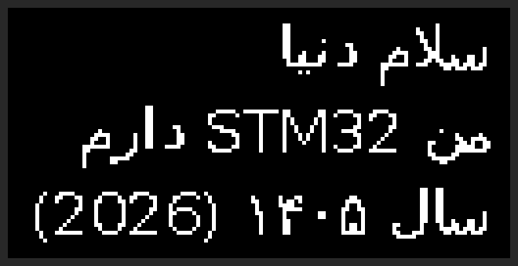

# parsi-display

**Correct Persian text on tiny embedded screens.**

Persian is written right to left, and every letter changes shape depending on where it sits in a word. Desktop systems handle this with large libraries such as HarfBuzz and FriBidi, which are far too big for a microcontroller. So most cheap devices show Persian as disconnected, backwards letters, or not at all.

`parsi-display` is a small C99 engine (no `malloc`, no dependencies, a few KB of flash) that turns UTF-8 Persian into glyphs in drawing order, ready for a bitmap renderer on an STM32 driving an OLED.



## What the engine handles

- Contextual forms (isolated / initial / medial / final), including پ چ ژ ک گ ی
- Lam-alef ligatures: لا لآ لأ لإ
- ZWNJ (نیم‌فاصله), as in می‌خواهم
- English words and numbers kept left to right inside a Persian line
- Persian, Arabic-Indic and ASCII digits, including decimals
- Mirrored brackets in right-to-left text
- Optional normalisation of Arabic ك ي ى to Persian ک ی

## Build and test (Linux)

```sh
make
make test
./build/ps_demo "سلام دنیا"
```

## Roadmap

- [x] 1. Shaping + bidi engine in C, with host tests
- [ ] 2. Bitmap font format keyed by presentation-form code point
- [ ] 3. Avalonia font studio (C#, MVVM) using this engine via P/Invoke
- [ ] 4. STM32 firmware: SSD1306 OLED driver over I²C and text renderer
- [ ] 5. Live link: app sends text over USB serial, device redraws
- [ ] 6. Photos of real hardware, size/speed measurements, CI

## Known limits

- One line at a time; paragraph direction is right to left
- Simplified bidi, not the full Unicode Bidi Algorithm
- Diacritics are dropped unless `PS_FLAG_KEEP_MARKS` is set
